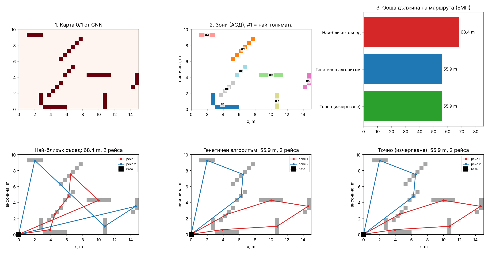

# 🚁 Дрон инспектор на сгради

Интердисциплинарен екипен проект · Раздел III „Конволюционни мрежи“ · **Тема 2**
НМ („Невронни мрежи“) · АСД („Алгоритми и структури от данни“) · ЕМП („Евристични методи за прогнозиране“) · XIIВ

*English: [README.en.md](README.en.md)*

Дрон снима стена → снимката се нарязва на плочки → **CNN** намира плочките с пукнатини → **рекурсивно обхождане** очертава повредените зони → **евристика** планира повторния полет само над тях, като спазва ограничението на батерията.



## Конвейер

```
снимка ─► [НМ] CNN: P(пукнатина) за всяка плочка 227×227 ─► карта 0/1 (R × C)
       ─► [АСД] рекурсивно обхождане → свързани зони → сортиране по площ (merge sort)
       ─► [ЕМП] маршрут през центровете на зоните с батерия: най-близък съсед vs генетичен алгоритъм
                (сравнени с точното решение при ≤ 8 зони)
       ─► план за повторния полет
```

Пълни блок схеми, комуникацията между модулите и форматите на данните: **[docs/arhitektura.md](docs/arhitektura.md)**.

## Една задача – три оценки

| Дисциплина | Тетрадка | Какво съдържа |
|---|---|---|
| **НМ** | [`notebooks/01_NM_CNN_pukmatini.ipynb`](notebooks/01_NM_CNN_pukmatini.ipynb) | собствен CNN срещу MobileNetV2 (трансферно обучение); формули, оптимизатор, регуляризация; праг по пълнота ≥ 99 %; матрица на объркванията, прецизност, пълнота, F1; карта 0/1 на стена |
| **АСД** | [`notebooks/02_ASD_zoni_s_pukmatini.ipynb`](notebooks/02_ASD_zoni_s_pukmatini.ipynb) | рекурсивно обхождане на решетката (като пътища в лабиринт), сортиране чрез сливане по площ, сложност O(R·C) и O(k log k), тестове |
| **ЕМП** | [`notebooks/03_EMP_marshrut_na_drona.ipynb`](notebooks/03_EMP_marshrut_na_drona.ipynb) | матрица на разстоянията, най-близък съсед vs генетичен алгоритъм, сравнение с точното решение по качество и време, извод |

**Важна метрика:** пълнота – пропусната пукнатина е по-скъпа от излишна проверка.

## Резултати (АСД и ЕМП – измерени)

| | Най-близък съсед | Генетичен алгоритъм | Точно решение |
|---|---|---|---|
| n = 4…8 зони, 100 задачи: средно отклонение от оптимума | 6–26 % (макс. 113 %) | **0 %** (100/100 оптимални) | 0 % |
| n = 8: средно време | 0.02 ms | 56 ms | 200 ms (расте като n!) |
| n = 10…60: колко по-къс е маршрутът на ГА | – | **11–26 %** | неприложимо |
| Демо стена 20 × 30, 8 зони | 68.4 m | **55.9 m** | 55.9 m |

Рекурсивното обхождане: ~0.5 µs на клетка (линейно), 48 теста по АСД, 69 теста общо.
**НМ:** числата се получават след обучение в Colab (T4 GPU, ~30–40 мин) – вижте `results/nm_metrics.csv` след пускане.

## Бързо пускане

**В Google Colab** (препоръчително за НМ): отворете тетрадката → *Runtime → Change runtime type → T4 GPU* → в първата клетка сменете `REPO_URL` с адреса на това хранилище → *Run all*.

**Локално** (АСД и ЕМП не изискват GPU):

```bash
pip install -r requirements.txt
python -m pytest -q                 # всички тестове
python -m src.pipeline              # демо: карта → зони → маршрути → results/pipeline_demo.png
python -m src.pipeline --map results/crack_map.npy   # с картата от CNN
```

## Уеб приложение и ултразвук

* **Сайт** (`web/`, на български и английски): мониторинг на мисията, анализ на стената, маршрут, проверка на място с ултразвук, песочница и пълна схема „Как работи“. Без сървър: `python -m http.server 8000 -d web`. Подробности: [`docs/web.md`](docs/web.md).
* **Ултразвук** (`src/ultrasound.py`): далекомер на дрона (снима само при стабилни 3 m, размер на плочката от разстоянието) и ръчна проверка на място (дълбочина на пукнатина по BS 1881-203, клас на бетона по IS 13311-1).
* **Концепция и план до защитата**: [`docs/koncepciya.md`](docs/koncepciya.md).

## Структура

```
├── README.md
├── requirements.txt
├── notebooks/        01_NM… · 02_ASD… · 03_EMP…
├── src/              общ код (единственото място с алгоритмите)
│   ├── tiling.py         снимка ↔ плочки ↔ карта 0/1
│   ├── grid_zones.py     АСД: рекурсивно обхождане + merge sort
│   ├── route_planning.py ЕМП: най-близък съсед, ГА, точно решение
│   ├── pipeline.py       интеграция на конвейера + CLI
│   ├── ultrasound.py     ултразвук: далекомер + проверка на място
│   └── viz.py            графики
├── web/              сайтът (статичен, BG/EN), виж docs/web.md
├── tools/            демо данни, еталони за JS тестовете, схемата на сайта
├── tests/            pytest
├── data/README.md    откъде и как се изтеглят данните (данните НЕ се качват)
├── results/          графики, метрики, карти
├── docs/             архитектура, блок схеми, работа в екип
└── presentation/     презентация по НМ
```

## Данни

**Concrete Crack Images for Classification** – 40 000 снимки 227 × 227, 2 класа. Özgenel, Ç. F. (2019), Mendeley Data, V2, DOI [10.17632/5y9wdsg2zt.2](https://doi.org/10.17632/5y9wdsg2zt.2). Лиценз и цитиране: [`data/README.md`](data/README.md).

## Екип

| Роля | Име | Отговаря за |
|---|---|---|
| Ръководител / интегратор | … | README, график, `src/pipeline.py`, финална демонстрация |
| Данни и CNN (НМ) | … | `01_NM…`, `src/tiling.py`, презентация |
| Алгоритми (АСД) | … | `02_ASD…`, `src/grid_zones.py`, тестове |
| Евристики (ЕМП) | … | `03_EMP…`, `src/route_planning.py`, графики |

Работен процес в GitHub и разпределение на задачите: [`docs/rabota_v_ekip.md`](docs/rabota_v_ekip.md).

## Източници

1. Özgenel, Ç. F. (2019). *Concrete Crack Images for Classification*. Mendeley Data, V2. doi:10.17632/5y9wdsg2zt.2
2. Özgenel, Ç. F., Gönenç Sorguç, A. (2018). *Performance Comparison of Pretrained CNNs on Crack Detection in Buildings*. ISARC 2018.
3. Sandler, M. et al. (2018). *MobileNetV2: Inverted Residuals and Linear Bottlenecks*. CVPR.
4. Prins, C. (2004). *A simple and effective evolutionary algorithm for the vehicle routing problem*. Computers & Operations Research 31 – идеята за декодер `split`.
5. Kingma, D. P., Ba, J. (2015). *Adam: A Method for Stochastic Optimization*. ICLR.

Генериран с ИИ код е разрешен, ако екипът може да го обясни ред по ред – всеки член трябва да може да обясни целия конвейер.
