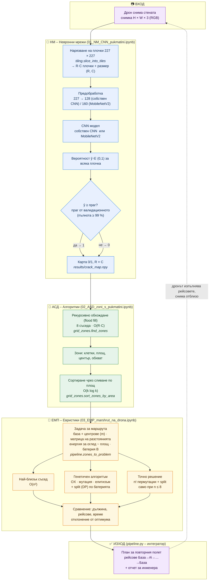
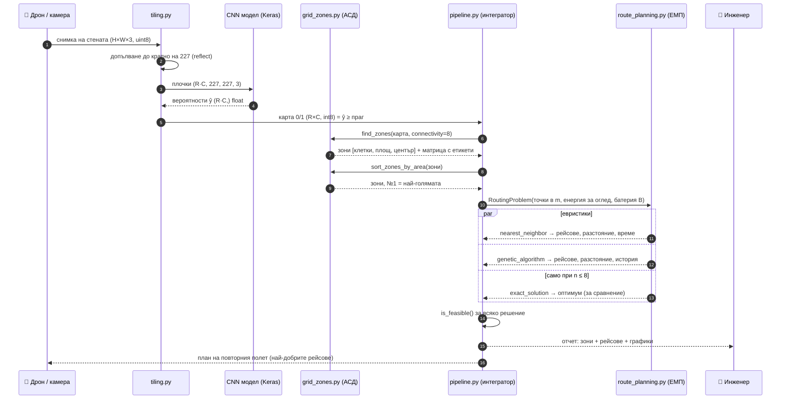
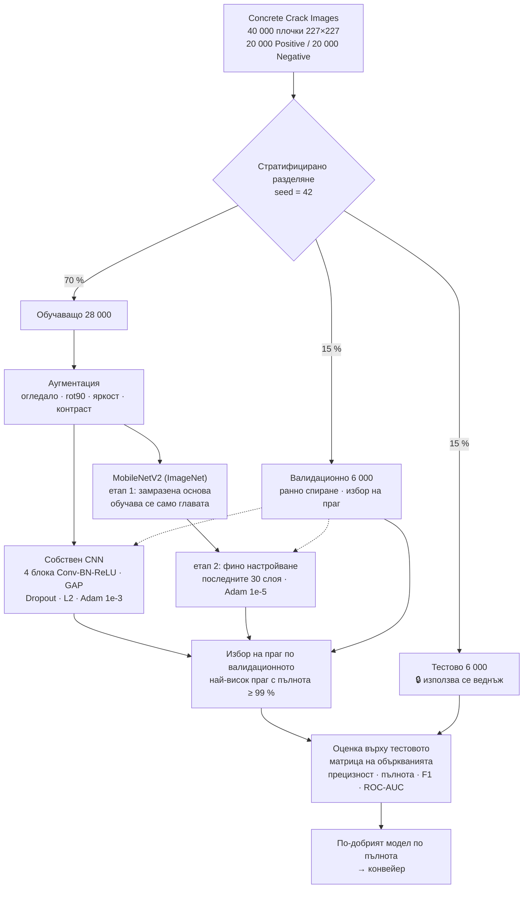
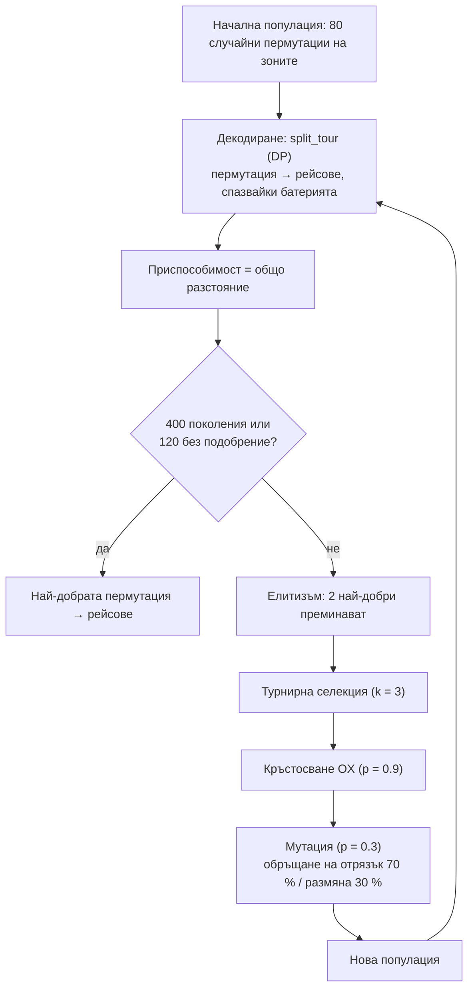
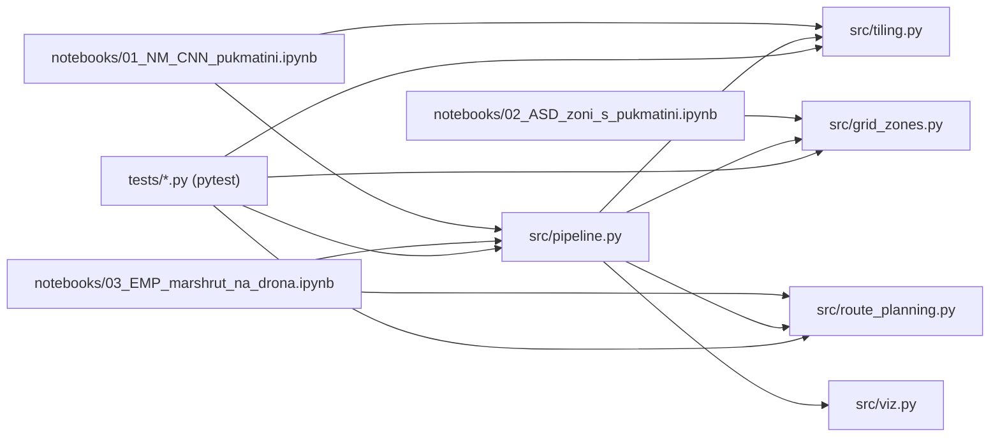

# Архитектура и блок схеми

Как работи целият конвейер: какво влиза, какво излиза и как „говорят“ помежду си моделите и модулите.
Схемите са в Mermaid (GitHub ги рисува директно); готови PNG за презентацията са в `docs/diagrams/`.

## 1. Общ конвейер (поток на данните)

## 2. Комуникация между модулите (кой какво подава на кого)

## 3. Договори за данните (интерфейси между частите)

Всяка част може да се разработва и тества отделно, стига да спазва формата на входа/изхода си.

| # | От → към | Функция | Формат | Пример |
|---|---|---|---|---|
| 1 | Дрон → НМ | – | снимка `np.ndarray (H, W, 3) uint8` | 4540 × 6810 × 3 |
| 2 | нарязване → CNN | `tiling.slice_into_tiles(img, 227)` | плочки `(R·C, 227, 227, 3)` + `(R, C)`; ред по редове | (600, 227, 227, 3), (20, 30) |
| 3 | CNN → праг | `model.predict(...)` | `ŷ (R·C,) float ∈ (0, 1)` | 0.97, 0.02, … |
| 4 | **НМ → АСД** | `tiling.probs_to_map(ŷ, (R, C), праг)` | **карта 0/1 `(R, C) int8`**, файл `results/crack_map.npy` | 1 = пукнатина |
| 5 | АСД вътрешно | `grid_zones.find_zones(grid, 8)` | `[Zone]` + матрица с етикети `(R, C)` | Zone(id, cells, area, center, bbox) |
| 6 | АСД вътрешно | `grid_zones.sort_zones_by_area(zones)` | `[Zone]`, №1 = най-голямата | |
| 7 | **АСД → ЕМП** | `pipeline.zones_to_problem(zones, (R, C), cfg)` | `RoutingProblem`: точки в m (0 = база), `service[i] = площ·цена`, `battery` | x = кол·0.5 m, y = (R − ред)·0.5 m |
| 8 | ЕМП → изход | `nearest_neighbor` / `genetic_algorithm` / `exact_solution` | `RouteResult`: `trips [[i, …], …]`, `distance`, `seconds`, `history` | [[6, 3, 5, 7, 1], [4, 2, 8]] |
| 9 | проверка | `route_planning.is_feasible(problem, trips)` | всяка зона точно веднъж, всеки рейс ≤ батерията | True |

**Координати:** ред 0 е най-горният ред плочки, затова височината над земята е `y = (R − ред) · tile_m`. Базата е в `(0, 0)` – долу вляво пред стената.

## 4. Обучение на невронната мрежа (НМ)

## 5. Генетичен алгоритъм (ЕМП)

## 6. Зависимости между файловете

* `src/` е **единственото място с кода** – тетрадките го импортират и показват (функция `show`), тестовете го проверяват.
* Частите след CNN (АСД, ЕМП, `pipeline.py`) не зависят от TensorFlow – пускат се на всеки компютър: `python -m src.pipeline`.
* Единствената връзка между НМ и останалото е **картата 0/1** (`results/crack_map.npy`) – затова екипът може да работи паралелно: докато мрежата се обучава, АСД и ЕМП работят със случайни карти (`tiling.random_crack_mask`).

## 7. Защо е разделено така (решения и компромиси)

| Решение | Алтернатива | Защо избрахме това |
|---|---|---|
| Класификация на плочки 227 × 227 | Сегментация по пиксели (U-Net) | Наборът е за класификация; картата 0/1 е точно входът, който АСД иска. Минус: груба резолюция (0.5 m). |
| Праг по пълнота ≥ 99 % | Праг 0.5 | FN (пропусната пукнатина) е много по-скъп от FP (излишна плочка за оглед). |
| 8-свързаност | 4-свързаност | Пукнатините вървят по диагонал; с 4 съседа една пукнатина се „чупи“ на много зони → повече излишни точки в маршрута. |
| Рекурсия (flood fill) | BFS/DFS с опашка/стек | Темата е рекурсия (I срок по АСД); итеративният вариант е само за проверка. |
| ГА с декодер `split_tour` | ГА, който сам „реже“ рейсовете | Всяка пермутация е допустима → няма наказателни функции; разделянето е оптимално за дадения ред. |
| Точно решение = n! пермутации + split | Динамично програмиране по подмножества | По-лесно за обяснение и доказване; достатъчно за n ≤ 8. |
